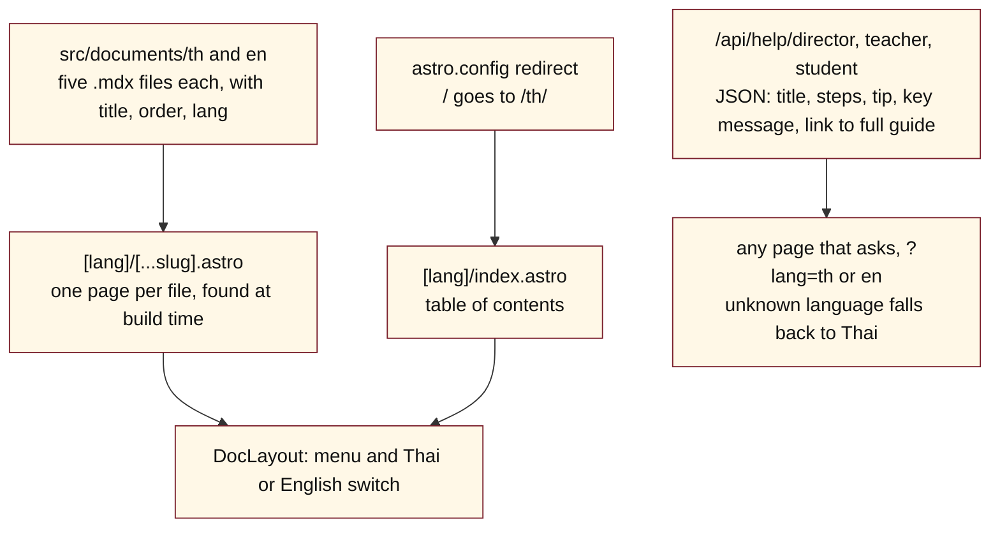

# NickoSystems instruction book — Module: Schools user guide (cuppathai-schools)

> How to use this file: Part 1 explains the module, Part 2 lists the files, Part 3 is the complete current code. No secret keys are included.

## Part 1. What this module is

- **What:** the written user guide for the CuppaThai school product, in Thai and English: Getting Started, Director, Teacher, Student, and Demo. It is a small static Astro site. It has no database and no login.
- **Repository:** https://github.com/CuppaThai/cuppathai-schools (**public**, so anyone can read it). Never put a secret or a real customer's details in it.
- **Where it is served:** the guide's own links point at `cuppathai-schools.pages.dev`. The repository has no Cloudflare config file, so the hosting setup is in the Cloudflare dashboard, not in the code.
- **Not the same as the village school:** the live school system is the village school Worker (see its module). This repository only holds the written guides and a tiny help API.

### Diagram 1. How the guide is built and read



### Editing the guide

1. Edit the .mdx file in **both** languages.
2. Keep the front matter: title, description, order, lang.
3. A new page needs a link added in `[lang]/index.astro`.
4. The short step lists in `/api/help/*` are written by hand in the code, separate from the .mdx pages. Change both when the process changes.

### Rules and known traps

- `05-demo` lists demo logins (a demo student, teacher code and director). They must stay demo-only accounts, because this repository is public.
- I found no page in the other repositories that calls `/api/help`. Check before changing its shape.
- The Teacher guide describes the institutional school flow (director, CSV upload, EPUB by Line). The paid village flow works differently (see the village school module), so do not copy village rules here.

## Part 2. File map (full web addresses)

- https://github.com/CuppaThai/cuppathai-schools/blob/main/.gitignore  (264 bytes)
- https://github.com/CuppaThai/cuppathai-schools/blob/main/.vscode/extensions.json  (87 bytes)
- https://github.com/CuppaThai/cuppathai-schools/blob/main/.vscode/launch.json  (207 bytes)
- https://github.com/CuppaThai/cuppathai-schools/blob/main/AGENTS.md  (874 bytes)
- https://github.com/CuppaThai/cuppathai-schools/blob/main/README.md  (1657 bytes)
- https://github.com/CuppaThai/cuppathai-schools/blob/main/astro.config.mjs  (217 bytes)
- https://github.com/CuppaThai/cuppathai-schools/blob/main/docs/book/modules.json  (317 bytes)
- https://github.com/CuppaThai/cuppathai-schools/blob/main/docs/book/schools-guide.header.md  (3296 bytes)
- https://github.com/CuppaThai/cuppathai-schools/blob/main/package.json  (292 bytes)
- https://github.com/CuppaThai/cuppathai-schools/blob/main/scripts/build-module-book.mjs  (2546 bytes)
- https://github.com/CuppaThai/cuppathai-schools/blob/main/src/components/Welcome.astro  (4937 bytes)
- https://github.com/CuppaThai/cuppathai-schools/blob/main/src/documents/config.ts  (303 bytes)
- https://github.com/CuppaThai/cuppathai-schools/blob/main/src/documents/en/01-getting-started.mdx  (1615 bytes)
- https://github.com/CuppaThai/cuppathai-schools/blob/main/src/documents/en/02-director.mdx  (1115 bytes)
- https://github.com/CuppaThai/cuppathai-schools/blob/main/src/documents/en/03-teacher.mdx  (5590 bytes)
- https://github.com/CuppaThai/cuppathai-schools/blob/main/src/documents/en/04-student.mdx  (1698 bytes)
- https://github.com/CuppaThai/cuppathai-schools/blob/main/src/documents/en/05-demo.mdx  (807 bytes)
- https://github.com/CuppaThai/cuppathai-schools/blob/main/src/documents/th/01-getting-started.mdx  (3446 bytes)
- https://github.com/CuppaThai/cuppathai-schools/blob/main/src/documents/th/02-director.mdx  (2754 bytes)
- https://github.com/CuppaThai/cuppathai-schools/blob/main/src/documents/th/03-teacher.mdx  (12396 bytes)
- https://github.com/CuppaThai/cuppathai-schools/blob/main/src/documents/th/04-student.mdx  (3382 bytes)
- https://github.com/CuppaThai/cuppathai-schools/blob/main/src/documents/th/05-demo.mdx  (1570 bytes)
- https://github.com/CuppaThai/cuppathai-schools/blob/main/src/layouts/DocLayout.astro  (4149 bytes)
- https://github.com/CuppaThai/cuppathai-schools/blob/main/src/layouts/Layout.astro  (438 bytes)
- https://github.com/CuppaThai/cuppathai-schools/blob/main/src/pages/%5Blang%5D/%5B...slug%5D.astro  (844 bytes)
- https://github.com/CuppaThai/cuppathai-schools/blob/main/src/pages/%5Blang%5D/index.astro  (1275 bytes)
- https://github.com/CuppaThai/cuppathai-schools/blob/main/src/pages/api/help/director/index.json.js  (2035 bytes)
- https://github.com/CuppaThai/cuppathai-schools/blob/main/src/pages/api/help/student/index.json.js  (2008 bytes)
- https://github.com/CuppaThai/cuppathai-schools/blob/main/src/pages/api/help/teacher/index.json.js  (2273 bytes)
- https://github.com/CuppaThai/cuppathai-schools/blob/main/tsconfig.json  (109 bytes)

## Part 3. The code

Generated 2026-10-11 from the current `main` branch. Each file starts with "FILE: name".

### FILE: .gitignore
https://github.com/CuppaThai/cuppathai-schools/blob/main/.gitignore

```
# build output
dist/

# generated types
.astro/

# dependencies
node_modules/

# logs
npm-debug.log*
yarn-debug.log*
yarn-error.log*
pnpm-debug.log*

# environment variables
.env
.env.production

# macOS-specific files
.DS_Store

# jetbrains setting folder
.idea/
```

### FILE: .vscode/extensions.json
https://github.com/CuppaThai/cuppathai-schools/blob/main/.vscode/extensions.json

```json
{
  "recommendations": ["astro-build.astro-vscode"],
  "unwantedRecommendations": []
}
```

### FILE: .vscode/launch.json
https://github.com/CuppaThai/cuppathai-schools/blob/main/.vscode/launch.json

```json
{
  "version": "0.2.0",
  "configurations": [
    {
      "command": "./node_modules/.bin/astro dev",
      "name": "Development server",
      "request": "launch",
      "type": "node-terminal"
    }
  ]
}
```

### FILE: AGENTS.md
https://github.com/CuppaThai/cuppathai-schools/blob/main/AGENTS.md

~~~~md
## Development

When starting the dev server, use background mode:

```
astro dev --background
```

Manage the background server with `astro dev stop`, `astro dev status`, and `astro dev logs`.

## Documentation

Full documentation: https://docs.astro.build

Consult these guides before working on related tasks:

- [Adding pages, dynamic routes, or middleware](https://docs.astro.build/en/guides/routing/)
- [Working with Astro components](https://docs.astro.build/en/basics/astro-components/)
- [Using React, Vue, Svelte, or other framework components](https://docs.astro.build/en/guides/framework-components/)
- [Adding or managing content](https://docs.astro.build/en/guides/content-collections/)
- [Adding styles or using Tailwind](https://docs.astro.build/en/guides/styling/)
- [Supporting multiple languages](https://docs.astro.build/en/guides/internationalization/)
~~~~

### FILE: README.md
https://github.com/CuppaThai/cuppathai-schools/blob/main/README.md

~~~~md
# Astro Starter Kit: Basics

```sh
npm create astro@latest -- --template basics
```

> 🧑‍🚀 **Seasoned astronaut?** Delete this file. Have fun!

## 🚀 Project Structure

Inside of your Astro project, you'll see the following folders and files:

```text
/
├── public/
│   └── favicon.svg
├── src
│   ├── assets
│   │   └── astro.svg
│   ├── components
│   │   └── Welcome.astro
│   ├── layouts
│   │   └── Layout.astro
│   └── pages
│       └── index.astro
└── package.json
```

To learn more about the folder structure of an Astro project, refer to [our guide on project structure](https://docs.astro.build/en/basics/project-structure/).

## 🧞 Commands

All commands are run from the root of the project, from a terminal:

| Command                   | Action                                           |
| :------------------------ | :----------------------------------------------- |
| `npm install`             | Installs dependencies                            |
| `npm run dev`             | Starts local dev server at `localhost:4321`      |
| `npm run build`           | Build your production site to `./dist/`          |
| `npm run preview`         | Preview your build locally, before deploying     |
| `npm run astro ...`       | Run CLI commands like `astro add`, `astro check` |
| `npm run astro -- --help` | Get help using the Astro CLI                     |

## 👀 Want to learn more?

Feel free to check [our documentation](https://docs.astro.build) or jump into our [Discord server](https://astro.build/chat).
~~~~

### FILE: astro.config.mjs
https://github.com/CuppaThai/cuppathai-schools/blob/main/astro.config.mjs

```js
// @ts-check
import { defineConfig } from 'astro/config';
import mdx from '@astrojs/mdx';

// https://astro.build/config
export default defineConfig({
  integrations: [mdx()],
  redirects: {
    '/': '/th/',
  },
});
```

### FILE: docs/book/modules.json
https://github.com/CuppaThai/cuppathai-schools/blob/main/docs/book/modules.json

```json
{
  "repo": "CuppaThai/cuppathai-schools",
  "neverInclude": "\\.(png|jpe?g|webp|svg|mp3|mp4|woff2?|ico|pdf|zip|epub)$|package-lock\\.json$|^docs/book/module-",
  "modules": [
    { "id": "schools-guide", "header": "docs/book/schools-guide.header.md", "out": "docs/book/module-schools-guide.md", "rest": true }
  ]
}
```

### FILE: docs/book/schools-guide.header.md
https://github.com/CuppaThai/cuppathai-schools/blob/main/docs/book/schools-guide.header.md

~~~~md
# NickoSystems instruction book — Module: Schools user guide (cuppathai-schools)

> How to use this file: Part 1 explains the module, Part 2 lists the files, Part 3 is the complete current code. No secret keys are included.

## Part 1. What this module is

- **What:** the written user guide for the CuppaThai school product, in Thai and English: Getting Started, Director, Teacher, Student, and Demo. It is a small static Astro site. It has no database and no login.
- **Repository:** https://github.com/CuppaThai/cuppathai-schools (**public**, so anyone can read it). Never put a secret or a real customer's details in it.
- **Where it is served:** the guide's own links point at `cuppathai-schools.pages.dev`. The repository has no Cloudflare config file, so the hosting setup is in the Cloudflare dashboard, not in the code.
- **Not the same as the village school:** the live school system is the village school Worker (see its module). This repository only holds the written guides and a tiny help API.

### Diagram 1. How the guide is built and read


### Editing the guide

1. Edit the .mdx file in **both** languages.
2. Keep the front matter: title, description, order, lang.
3. A new page needs a link added in `[lang]/index.astro`.
4. The short step lists in `/api/help/*` are written by hand in the code, separate from the .mdx pages. Change both when the process changes.

### Rules and known traps

- `05-demo` lists demo logins (a demo student, teacher code and director). They must stay demo-only accounts, because this repository is public.
- I found no page in the other repositories that calls `/api/help`. Check before changing its shape.
- The Teacher guide describes the institutional school flow (director, CSV upload, EPUB by Line). The paid village flow works differently (see the village school module), so do not copy village rules here.
~~~~

### FILE: package.json
https://github.com/CuppaThai/cuppathai-schools/blob/main/package.json

```json
{
  "name": "cuppathai-schools",
  "version": "1.0.0",
  "scripts": {
    "dev": "astro dev",
    "build": "astro build",
    "preview": "astro preview",
    "astro": "astro"
  },
  "dependencies": {
    "@astrojs/mdx": "^3.0.0",
    "@astrojs/sitemap": "^3.0.0",
    "astro": "^4.0.0"
  }
}
```

### FILE: scripts/build-module-book.mjs
https://github.com/CuppaThai/cuppathai-schools/blob/main/scripts/build-module-book.mjs

~~~~js
// scripts/build-module-book.mjs | NickoSystems instruction book builder | rev 2, 11 Oct 2026
// Reads docs/book/modules.json. For every module it joins the hand-written header (diagrams, rules) with the CURRENT code of
// that module's files, so a single file explains one module completely, even to an AI that cannot open the repository.
// Run:  node scripts/build-module-book.mjs        (writes docs/book/module-*.md)
import { execSync } from 'node:child_process';
import { readFileSync, writeFileSync, statSync } from 'node:fs';
const cfg = JSON.parse(readFileSync('docs/book/modules.json', 'utf8'));
const BASE = `https://github.com/${cfg.repo}/blob/main/`;
const NEVER = new RegExp(cfg.neverInclude || '\\.(png|jpe?g|webp|svg|mp3|mp4|woff2?|ico|pdf|zip|epub)$|package-lock\\.json$|^docs/book/module-');
const all = execSync('git ls-files', { encoding: 'utf8' }).split('\n').filter((f) => f && !NEVER.test(f)).sort();
const lang = (f) => ({ astro: 'astro', ts: 'ts', mjs: 'js', js: 'js', css: 'css', json: 'json', jsonc: 'json', html: 'html', yml: 'yaml', sql: 'sql', md: 'md', py: 'python' }[f.split('.').pop()] || '');
const url = (f) => BASE + f.split('/').map(encodeURIComponent).join('/');
const claimed = new Set();
for (const m of cfg.modules) {
  const inc = (m.include || []).map((r) => new RegExp(r)), exc = (m.exclude || []).map((r) => new RegExp(r));
  let files = all.filter((f) => !exc.some((r) => r.test(f)) && (m.rest ? !claimed.has(f) : inc.some((r) => r.test(f))));
  files.forEach((f) => claimed.add(f));
  const skipped = (m.dataFiles || []).map((f) => `- ${url(f)} (data or vendor file, left out of this book file)`).join('\n');
  if (m.noCode) { writeFileSync(m.out, readFileSync(m.header, 'utf8')); console.log(m.out + ': header only'); continue; }
  let out = readFileSync(m.header, 'utf8').trimEnd() + '\n\n## Part 2. File map (full web addresses)\n\n';
  out += files.map((f) => `- ${url(f)}  (${statSync(f).size} bytes)`).join('\n') + '\n';
  if (skipped) out += '\nLeft out on purpose:\n' + skipped + '\n';
  out += `\n## Part 3. The code\n\nGenerated ${new Date().toISOString().slice(0, 10)} from the current \`main\` branch. Each file starts with "FILE: name".\n\n`;
  for (const f of files) {
    const body = readFileSync(f, 'utf8'), fence = body.includes('```') ? '~~~~' : '```';
    out += `### FILE: ${f}\n${url(f)}\n\n${fence}${lang(f)}\n${body.trimEnd()}\n${fence}\n\n`;
  }
  writeFileSync(m.out, out);
  console.log(m.out + ': ' + files.length + ' files, ' + Math.round(out.length / 1024) + ' KB');
}
~~~~

### FILE: src/components/Welcome.astro
https://github.com/CuppaThai/cuppathai-schools/blob/main/src/components/Welcome.astro

```astro
---
import astroLogo from '../assets/astro.svg';
import background from '../assets/background.svg';
---

<div id="container">
	
	<main>
		<section id="hero">
			<a href="https://astro.build"
				></a
			>
			<h1>
				To get started, open the <code><pre>src/pages</pre></code> directory in your project.
			</h1>
			<section id="links">
				<a class="button" href="https://docs.astro.build">Read our docs</a>
				<a href="https://astro.build/chat"
					>Join our Discord <svg xmlns="http://www.w3.org/2000/svg" viewBox="0 0 127.14 96.36"
						><path
							fill="currentColor"
							d="M107.7 8.07A105.15 105.15 0 0 0 81.47 0a72.06 72.06 0 0 0-3.36 6.83 97.68 97.68 0 0 0-29.11 0A72.37 72.37 0 0 0 45.64 0a105.89 105.89 0 0 0-26.25 8.09C2.79 32.65-1.71 56.6.54 80.21a105.73 105.73 0 0 0 32.17 16.15 77.7 77.7 0 0 0 6.89-11.11 68.42 68.42 0 0 1-10.85-5.18c.91-.66 1.8-1.34 2.66-2a75.57 75.57 0 0 0 64.32 0c.87.71 1.76 1.39 2.66 2a68.68 68.68 0 0 1-10.87 5.19 77 77 0 0 0 6.89 11.1 105.25 105.25 0 0 0 32.19-16.14c2.64-27.38-4.51-51.11-18.9-72.15ZM42.45 65.69C36.18 65.69 31 60 31 53s5-12.74 11.43-12.74S54 46 53.89 53s-5.05 12.69-11.44 12.69Zm42.24 0C78.41 65.69 73.25 60 73.25 53s5-12.74 11.44-12.74S96.23 46 96.12 53s-5.04 12.69-11.43 12.69Z"
						></path></svg
					>
				</a>
			</section>
		</section>
	</main>

	<a href="https://astro.build/blog/astro-6-beta/" id="news" class="box">
		<svg width="32" height="32" fill="none" xmlns="http://www.w3.org/2000/svg"
			><path
				d="M24.667 12c1.333 1.414 2 3.192 2 5.334 0 4.62-4.934 5.7-7.334 12C18.444 28.567 18 27.456 18 26c0-4.642 6.667-7.053 6.667-14Zm-5.334-5.333c1.6 1.65 2.4 3.43 2.4 5.333 0 6.602-8.06 7.59-6.4 17.334C13.111 27.787 12 25.564 12 22.666c0-4.434 7.333-8 7.333-16Zm-6-5.333C15.111 3.555 16 5.556 16 7.333c0 8.333-11.333 10.962-5.333 22-3.488-.774-6-4-6-8 0-8.667 8.666-10 8.666-20Z"
				fill="#111827"></path></svg
		>
		<h2>What's New in Astro 6.0?</h2>
		<p>
			Redesigned dev server, fonts, live collections, built-in CSP support, and more! Click to
			explore Astro 6.0's new features.
		</p>
	</a>
</div>

<style>
	#background {
		position: fixed;
		top: 0;
		left: 0;
		width: 100%;
		height: 100%;
		z-index: -1;
		filter: blur(100px);
	}

	#container {
		font-family: Inter, Roboto, 'Helvetica Neue', 'Arial Nova', 'Nimbus Sans', Arial, sans-serif;
		height: 100%;
	}

	main {
		height: 100%;
		display: flex;
		justify-content: center;
	}

	#hero {
		display: flex;
		align-items: start;
		flex-direction: column;
		justify-content: center;
		padding: 16px;
	}

	h1 {
		font-size: 22px;
		margin-top: 0.25em;
	}

	#links {
		display: flex;
		gap: 16px;
	}

	#links a {
		display: flex;
		align-items: center;
		padding: 10px 12px;
		color: #111827;
		text-decoration: none;
		transition: color 0.2s;
	}

	#links a:hover {
		color: rgb(78, 80, 86);
	}

	#links a svg {
		height: 1em;
		margin-left: 8px;
	}

	#links a.button {
		color: white;
		background: linear-gradient(83.21deg, #3245ff 0%, #bc52ee 100%);
		box-shadow:
			inset 0 0 0 1px rgba(255, 255, 255, 0.12),
			inset 0 -2px 0 rgba(0, 0, 0, 0.24);
		border-radius: 10px;
	}

	#links a.button:hover {
		color: rgb(230, 230, 230);
		box-shadow: none;
	}

	pre {
		font-family:
			ui-monospace, 'Cascadia Code', 'Source Code Pro', Menlo, Consolas, 'DejaVu Sans Mono',
			monospace;
		font-weight: normal;
		background: linear-gradient(14deg, #d83333 0%, #f041ff 100%);
		-webkit-background-clip: text;
		-webkit-text-fill-color: transparent;
		background-clip: text;
		margin: 0;
	}

	h2 {
		margin: 0 0 1em;
		font-weight: normal;
		color: #111827;
		font-size: 20px;
	}

	p {
		color: #4b5563;
		font-size: 16px;
		line-height: 24px;
		letter-spacing: -0.006em;
		margin: 0;
	}

	code {
		display: inline-block;
		background:
			linear-gradient(66.77deg, #f3cddd 0%, #f5cee7 100%) padding-box,
			linear-gradient(155deg, #d83333 0%, #f041ff 18%, #f5cee7 45%) border-box;
		border-radius: 8px;
		border: 1px solid transparent;
		padding: 6px 8px;
	}

	.box {
		padding: 16px;
		background: rgba(255, 255, 255, 1);
		border-radius: 16px;
		border: 1px solid white;
	}

	#news {
		position: absolute;
		bottom: 16px;
		right: 16px;
		max-width: 300px;
		text-decoration: none;
		transition: background 0.2s;
		backdrop-filter: blur(50px);
	}

	#news:hover {
		background: rgba(255, 255, 255, 0.55);
	}

	@media screen and (max-height: 368px) {
		#news {
			display: none;
		}
	}

	@media screen and (max-width: 768px) {
		#container {
			display: flex;
			flex-direction: column;
		}

		#hero {
			display: block;
			padding-top: 10%;
		}

		#links {
			flex-wrap: wrap;
		}

		#links a.button {
			padding: 14px 18px;
		}

		#news {
			right: 16px;
			left: 16px;
			bottom: 2.5rem;
			max-width: 100%;
		}

		h1 {
			line-height: 1.5;
		}
	}
</style>
```

### FILE: src/documents/config.ts
https://github.com/CuppaThai/cuppathai-schools/blob/main/src/documents/config.ts

```ts
import { defineCollection, z } from 'astro:content';

const docs = defineCollection({
  type: 'content',
  schema: z.object({
    title: z.string(),
    description: z.string().optional(),
    order: z.number().optional(),
    lang: z.enum(['th', 'en']),
  }),
});

export const collections = { docs };
```

### FILE: src/documents/en/01-getting-started.mdx
https://github.com/CuppaThai/cuppathai-schools/blob/main/src/documents/en/01-getting-started.mdx

```
---
title: '🚀 Getting Started with CuppaThai'
description: 'Learn about the AI-powered English speaking practice system'
order: 1
lang: 'en'
---

## What is CuppaThai?

CuppaThai is an AI-powered English speaking practice system for Thai schools. Teachers don't need to speak English — AI is the language teacher.

## The Problem We Solve

- Teachers are not confident teaching English speaking
- Students are shy to speak in front of the class
- No consistent speaking practice
- Grading speaking is subjective

## Our Solution

- **AI scores** student speech instantly and objectively
- **Teachers host** the class (no English required)
- **Students practice** at home with EPUB (offline)
- **Weekly cycle** — 12 new phrases per week
- **PDPA compliant** — no real names stored

## Weekly Lesson Cycle

| Day | Activity |
|-----|----------|
| Day -7 | Payment due (School) |
| Day -5 | Teacher sends EPUB to students via Line |
| Day -4 to -1 | Students study EPUB at home |
| Day 0 | Class begins |
| Day +7 | Week 2 |

## Key Numbers

| Item | Value |
|------|-------|
| Phrases per week | 12 |
| Phrases per pack | 48 |
| Packs per grade | 10 |
| Total packs | 50 |
| Total phrases | 2,400 |
| Attempts per phrase | 3 |
| Attempts per class | 48 |

## Getting Started

1. Director sets up school and adds teachers
2. Teacher creates classrooms and adds students
3. Teacher assigns pack and sends EPUB to students
4. Students study EPUB at home
5. Students practice speaking in class with AI
6. Students do AI Scoring homework at home
7. Teacher reviews results and grades
8. Start new cycle next week
```

### FILE: src/documents/en/02-director.mdx
https://github.com/CuppaThai/cuppathai-schools/blob/main/src/documents/en/02-director.mdx

```
---
title: '👨‍💼 Director Guide'
description: 'Set up your school, manage teachers, and monitor progress'
order: 2
lang: 'en'
---

## Login

1. Go to `/director/`
2. Enter your email and password
3. Click "Login"

## School Overview

The director dashboard shows:
- Total students
- Total classrooms
- Total teachers
- Average school progress
- Average star score
- Payment status

## Managing Teachers

- **Add teacher:** Enter name and email, system generates Access Code
- **View teachers:** See all teachers in your school
- **Enable/Disable:** Activate or deactivate teacher accounts
- **Reset code:** Generate a new Access Code

## Managing Payments

- View payment status for each month
- See amount due (per student or flat fee)
- Get reminders when payment is due
- Pay **7 days** before the month starts

## Reports

- View progress by grade level
- See class-by-class performance
- Export data as CSV or PDF
- Track progress trends over time

## Tips

- Pay on time so students receive EPUB in advance
- Check the dashboard regularly to monitor progress
- Use AI data for administrative decisions
```

### FILE: src/documents/en/03-teacher.mdx
https://github.com/CuppaThai/cuppathai-schools/blob/main/src/documents/en/03-teacher.mdx

```
---
title: '👩‍🏫 Teacher Guide'
description: 'Create classrooms, add students, assign packs, and run class mode'
order: 3
lang: 'en'
---

## Login

1. Go to `/teacher/`
2. Enter your Access Code (provided by your director)
3. Click "Login"

## Create a Classroom

1. Click "Create Classroom"
2. Select grade level (M1–M6)
3. Enter room number (e.g., "01")
4. Click "Create" – system generates classroom code

## Add Students

- **Option 1:** Type each student's nickname manually
- **Option 2:** Upload CSV file (nickname, student number)

> CSV files are read in your browser and never uploaded to the server (PDPA compliant)

## Assign a Pack

1. Go to "Manage Class"
2. Click "Assign Pack"
3. System suggests pack by grade + month
4. Click "Assign" to confirm

## Distribute EPUB

1. Download EPUB from dashboard
2. Send file to students via Line
3. Instruct them to study Scene 1 before class

## Class Mode (/class/)

1. Open `/class/` on big screen
2. Call students to the microphone
3. Students speak, AI scores live (4 stars = PASS)
4. 48 attempts per class

## Review and Grade

1. Go to "Roster"
2. Click on a student
3. View progress: passed phrases, Honorary Pass, average stars
4. Grade based on AI data

### 🔒 See Real Names Privately

Students only ever appear as nickname, class, and PIN — that protects their privacy (see the CSV note above). If you want to match a nickname to the real student sitting in front of you, tap the 🔒 next to their name and type it in. This is saved only on your own device/browser — it's never sent anywhere, and no other teacher or the school system ever sees it.

### 📊 One Combined Score, Automatically

Each student's roster row shows an **Overall %**, combining:

- 🎤 **Speaking** — the AI scoring result
- 🧩 **Games** — how many practice-game phrases they've mastered
- ⏰ **Reliability** — how recently they've actually done anything

You don't calculate this — it updates automatically as students complete homework.

### ⭐ Rate Attitude in One Tap

Tap 1–5 next to a student's name to record how engaged or hardworking they seemed — the one thing AI can't measure. If your rating and their actual score disagree by a lot, a small ⚠ warning appears — worth a second look, since it can mean a quiet student who's actually doing fine, or a confident one who isn't.

### 🧩 See Who's Stuck on the Games

A student who's tried a game phrase 4+ times without passing gets a 🧩 flag on the roster — so you know who needs a nudge without checking every student's game history yourself.

### 🖨️ Print a Grading Report

Tap "🖨️ Print grading report" for one page with every student's speaking %, games %, reliability, your attitude rating, and their overall score — ready to file, with real names if you've set them with 🔒.

---

## 📋 Homework — What to Assign Every Week

After each class, assign these 3 tasks:

### Task 1: 📖 Study EPUB for Next Week (12 new phrases)

**Teacher says:**  
"Open your EPUB for this month. Go to the next scene (e.g., Scene 2, 3, or 4). Study the 12 phrases for next week. Listen to the audio, read the phonetics and Thai translation, practice speaking at home."

**Purpose:**
- Students prepare 5–7 days in advance
- Arrive confident and ready to speak
- Class time is used for practice, not teaching new content

### Task 2: 🎤 AI Scoring — This Week's Phrases

**Teacher says:**  
"Go to `/student/`, enter your classroom code, nickname, and PIN. Complete AI scoring for the 12 phrases we practiced today. You have 3 attempts per phrase. 4 stars = PASS. If you fail 3 times, you get an Honorary Pass 🌟 (check the EPUB page number shown)."

**Purpose:**
- Reinforce what was learned in class
- Get objective grades from AI
- Identify which students need extra practice

### Task 3: 🧩 Practice Games — This Week's Phrases

**Teacher says:**  
"Go to `/student/`, tap the 🧩 Games tab, and play Q&A Match and Sentence Scramble for today's 12 phrases. You can play as many times as you want — even after you've already passed, playing again is fine and helps you remember better."

**Purpose:**
- A second, more playful way to practice the same 12 phrases
- No pressure — unlimited retries, no penalty for taking longer
- Reinforces the phrases from a different angle (reading/structure, not just speaking) — the same phrase heard again every time a tile is tapped

### Task 4: 🗣️ Speaking Practice — Next Week's Phrases

**Teacher says:**  
"Practice saying next week's 12 phrases aloud at home. Open the EPUB, listen to the audio, and repeat until you feel confident."

**Purpose:**
- Reduce speaking anxiety
- Build confidence to speak in front of the class
- Make the class game more fun and engaging

### Example Homework Instruction (Say in Class)

> "Homework this week:
> 1. Open your EPUB, go to Scene 2. Study the 12 phrases for next week. Listen, read, practice speaking.
> 2. Go to `/student/` and complete AI scoring for today's 12 phrases. Everyone must finish.
> 3. Play the practice games (Match and Scramble) for today's 12 phrases — as many times as you like.
> 4. Practice speaking the Scene 2 phrases aloud at home until you're confident."

---

## Tips

- Send EPUB 5–7 days before class so students have time to prepare
- Use Line group to communicate with students
- Check who hasn't completed AI scoring and follow up with them
- Check the 🧩 stuck-on-games flag on the roster and give those students a nudge
- Print the grading report before parent meetings or report cards
```

### FILE: src/documents/en/04-student.mdx
https://github.com/CuppaThai/cuppathai-schools/blob/main/src/documents/en/04-student.mdx

```
---
title: '🧑‍🎓 Student Guide'
description: 'Login, complete AI scoring, and track your progress'
order: 4
lang: 'en'
---

## Login

1. Go to `/student/`
2. Enter:
   - **Classroom Code** (from your teacher)
   - **Nickname** (your nickname)
   - **PIN** (4-digit from your teacher)
3. Click "Login"

## AI Scoring Homework

1. On your dashboard, you'll see assigned phrases
2. Click a phrase to start speaking practice
3. Record your speech (3 attempts per phrase)
4. AI scores you 0–4 stars
5. **4 stars = PASS ✅**
6. **3 failures = Honorary Pass 🌟** (EPUB page number shown)

## Practice Games Homework

1. On your dashboard, tap the **🧩 Games** tab (next to 🗣️ Speaking)
2. Choose a game:
   - **🧩 Match** — tap a question, then tap its matching answer
   - **🔤 Scramble** — tap the words in the right order to rebuild the sentence
3. Every tile you tap plays the audio/video for that phrase — listen carefully
4. Get it right = ⭐⭐⭐⭐ and move to the next one
5. **No limit on tries** — get it wrong as many times as you need, there's no penalty
6. Already passed? Tap **🔁 Play again** any time — more practice is always good

## Track Your Progress

- Home page shows:
  - Total phrases passed
  - Average stars
  - Progress percentage
- Click "View All" for detailed list

## Opening EPUB Files

| Device | App |
|--------|-----|
| iPhone/iPad | Apple Books (pre‑installed) |
| Android | Lithium: EPUB Reader (free download) |

## Tips

- Practice at home with EPUB before class
- Take 5–7 days to prepare
- If you fail, review the EPUB page number shown
- Try the practice games too — a fun, low-pressure way to review the same phrases
```

### FILE: src/documents/en/05-demo.mdx
https://github.com/CuppaThai/cuppathai-schools/blob/main/src/documents/en/05-demo.mdx

```
---
title: '🎯 Demo Credentials'
description: 'Try CuppaThai with these demo credentials'
order: 5
lang: 'en'
---

## Demo Credentials

| Role | Login | URL |
|------|-------|-----|
| Student | DEMO-01 / Somchai / 1234 | `/student/` |
| Teacher | DEMO-1234 | `/teacher/` |
| Director | demo@cuppathai.com / demopass | `/director/` |

## Demo Control Panel

Use `/demo/` to show all three dashboards simultaneously.

## Classroom Demo Video

[Video of live classroom AI scoring]

## Sales Script

**Introduction (2 min):**  
"This is CuppaThai — English speaking practice for schools..."

**Student Demo (3 min):**  
Show student dashboard, homework, AI scoring...

**Teacher Demo (5 min):**  
Show roster, grading, class mode...

**Director Demo (3 min):**  
Show whole-school overview and reporting...
```

### FILE: src/documents/th/01-getting-started.mdx
https://github.com/CuppaThai/cuppathai-schools/blob/main/src/documents/th/01-getting-started.mdx

```
---
title: '🚀 เริ่มต้นใช้งาน CuppaThai'
description: 'ทำความรู้จักกับระบบ AI ที่ช่วยให้เรียนภาษาอังกฤษสนุกขึ้น'
order: 1
lang: 'th'
---

## CuppaThai คืออะไร?

CuppaThai คือระบบฝึกพูดภาษาอังกฤษด้วย AI สำหรับโรงเรียนไทย ครูไม่ต้องพูดภาษาอังกฤษ — AI เป็นครูสอนภาษา

## ปัญหาที่เราแก้

- ครูไม่มั่นใจในการสอนพูดภาษาอังกฤษ
- นักเรียนเขินอายที่จะพูดหน้าชั้นเรียน
- ไม่มีการฝึกพูดอย่างสม่ำเสมอ
- การให้เกรดการพูดเป็นเรื่องยาก

## วิธีแก้ของเรา

- **AI ให้คะแนน** การพูดของนักเรียนทันทีและเป็นกลาง
- **ครูเป็นพิธีกร** ไม่ต้องพูดภาษาอังกฤษ
- **นักเรียนฝึกที่บ้าน** ด้วย EPUB (ไม่ต้องใช้อินเทอร์เน็ต)
- **รอบเรียนรายสัปดาห์** — 12 ประโยคใหม่ต่อสัปดาห์
- **สอดคล้องกับ PDPA** — ไม่เก็บชื่อจริง

## วงจรการเรียนรายสัปดาห์

| วัน | กิจกรรม |
|-----|---------|
| วัน -7 | ชำระเงิน (โรงเรียน) |
| วัน -5 | ครูส่ง EPUB ให้นักเรียนทาง Line |
| วัน -4 ถึง -1 | นักเรียนศึกษา EPUB ที่บ้าน |
| วัน 0 | เริ่มเรียนในห้องเรียน |
| วัน +7 | สัปดาห์ที่ 2 |

## ตัวเลขสำคัญ

| รายการ | ค่า |
|--------|-----|
| ประโยคต่อสัปดาห์ | 12 |
| ประโยคต่อแพ็ก | 48 |
| แพ็กต่อระดับชั้น | 10 |
| แพ็กทั้งหมด | 50 |
| ประโยคทั้งหมด | 2,400 |
| ความพยายามต่อประโยค | 3 |
| ความพยายามต่อคาบเรียน | 48 |

## เริ่มต้นใช้งาน

1. ผู้บริหารตั้งค่าโรงเรียนและเพิ่มครู
2. ครูสร้างห้องเรียนและเพิ่มนักเรียน
3. ครูกำหนดแพ็กและส่ง EPUB ให้นักเรียน
4. นักเรียนศึกษา EPUB ที่บ้าน
5. นักเรียนฝึกพูดในห้องเรียนด้วย AI
6. นักเรียนทำการบ้าน AI Scoring ที่บ้าน
7. ครูตรวจสอบผลและให้เกรด
8. เริ่มวงจรใหม่ในสัปดาห์ถัดไป
```

### FILE: src/documents/th/02-director.mdx
https://github.com/CuppaThai/cuppathai-schools/blob/main/src/documents/th/02-director.mdx

```
---
title: '👨‍💼 คู่มือผู้บริหาร'
description: 'ตั้งค่าโรงเรียน จัดการครู และดูภาพรวมความก้าวหน้า'
order: 2
lang: 'th'
---

## การเข้าสู่ระบบ

1. ไปที่ `/director/`
2. ใส่อีเมลและรหัสผ่านที่ได้รับ
3. คลิก "เข้าสู่ระบบ"

## ภาพรวมโรงเรียน

แดชบอร์ดผู้บริหารจะแสดง:
- จำนวนนักเรียนทั้งหมด
- จำนวนห้องเรียน
- จำนวนครู
- ความก้าวหน้าเฉลี่ยของโรงเรียน
- คะแนนเฉลี่ย (ดาว)
- สถานะการชำระเงิน

## การจัดการครู

- **เพิ่มครู:** กรอกชื่อและอีเมล ระบบสร้างรหัสครู (Access Code)
- **ดูรายชื่อครู:** ดูครูทั้งหมดในโรงเรียน
- **เปิด/ปิดใช้งาน:** เปิดหรือปิดการใช้งานบัญชีครู
- **รีเซ็ตรหัส:** สร้างรหัสครูใหม่

## การจัดการการชำระเงิน

- ดูสถานะการชำระเงินของแต่ละเดือน
- ดูยอดเงินที่ต้องชำระ (ต่อนักเรียนหรือแบบเหมา)
- แจ้งเตือนเมื่อการชำระเงินใกล้ครบกำหนด
- ชำระเงินล่วงหน้า **7 วัน** ก่อนเริ่มเดือน

## การดูรายงาน

- ดูความก้าวหน้าแยกรายระดับชั้น
- ดูผลการเรียนของแต่ละห้องเรียน
- ส่งออกข้อมูลเป็น CSV หรือ PDF
- ดูแนวโน้มความก้าวหน้าตามเวลา

## เคล็ดลับ

- ชำระเงินตรงเวลาเพื่อให้นักเรียนได้รับ EPUB ทันเวลา
- ตรวจสอบแดชบอร์ดเป็นประจำเพื่อติดตามความคืบหน้า
- ใช้ข้อมูลจาก AI ในการตัดสินใจเชิงบริหาร
```

### FILE: src/documents/th/03-teacher.mdx
https://github.com/CuppaThai/cuppathai-schools/blob/main/src/documents/th/03-teacher.mdx

```
---
title: '👩‍🏫 คู่มือครู'
description: 'สร้างห้องเรียน เพิ่มนักเรียน กำหนดแพ็ก และโหมดห้องเรียน'
order: 3
lang: 'th'
---

## การเข้าสู่ระบบ

1. ไปที่ `/teacher/`
2. ใส่รหัสครู (Access Code) ที่ได้รับจากผู้บริหาร
3. คลิก "เข้าสู่ระบบ"

## การสร้างห้องเรียน

1. คลิก "สร้างห้องเรียน"
2. เลือกระดับชั้น (ม.1–ม.6)
3. ป้อนหมายเลขห้อง (เช่น "01")
4. คลิก "สร้าง" ระบบจะสร้างรหัสห้องอัตโนมัติ

## การเพิ่มนักเรียน

- **วิธีที่ 1:** พิมพ์ชื่อเล่นของนักเรียนแต่ละคน
- **วิธีที่ 2:** อัปโหลดไฟล์ CSV (ชื่อเล่น, เลขที่)

> ไฟล์ CSV จะถูกอ่านในเครื่องเบราว์เซอร์ของคุณเท่านั้น ไม่ได้อัปโหลดขึ้นเซิร์ฟเวอร์ (สอดคล้องกับ PDPA)

## การกำหนดแพ็ก

1. ไปที่ "จัดการชั้นเรียน"
2. คลิก "กำหนดแพ็ก"
3. ระบบจะแนะนำแพ็กตามระดับชั้นและเดือน
4. คลิก "กำหนด" เพื่อยืนยัน

## การแจกจ่าย EPUB

1. ดาวน์โหลด EPUB จากแดชบอร์ด
2. ส่งไฟล์ให้นักเรียนทาง Line
3. แนะนำให้ศึกษา Scene 1 ก่อนเรียน

## โหมดห้องเรียน (/class/)

1. เปิด `/class/` บนจอใหญ่
2. เรียกนักเรียนมาที่ไมโครโฟน
3. นักเรียนพูด AI ให้คะแนนสด (4 ดาว = ผ่าน)
4. มี 48 ครั้งต่อคาบเรียน

## การตรวจสอบและให้เกรด

1. ไปที่ "รายชื่อนักเรียน"
2. คลิกที่ชื่อนักเรียน
3. ดูผลการเรียน: ประโยคที่ผ่าน, Honorary Pass, คะแนนเฉลี่ย
4. ให้เกรดตามข้อมูลจาก AI

### 🔒 ดูชื่อจริงแบบส่วนตัว

นักเรียนจะแสดงเป็นชื่อเล่น ห้อง และ PIN เท่านั้น เพื่อปกป้องความเป็นส่วนตัว (ดูหมายเหตุเรื่อง CSV ด้านบน) หากต้องการจับคู่ชื่อเล่นกับตัวนักเรียนจริงที่อยู่ตรงหน้า ให้แตะ 🔒 ข้างชื่อแล้วพิมพ์ชื่อจริงเข้าไป ข้อมูลนี้จะถูกบันทึกไว้ในเครื่อง/เบราว์เซอร์ของคุณเท่านั้น ไม่ถูกส่งไปที่ไหนเลย และครูคนอื่นหรือระบบโรงเรียนจะไม่เห็นข้อมูลนี้

### 📊 คะแนนรวมอัตโนมัติ

แถวของนักเรียนแต่ละคนในรายชื่อจะแสดง **คะแนนรวม %** ซึ่งรวม:

- 🎤 **พูด** — ผลคะแนนจาก AI Scoring
- 🧩 **เกม** — จำนวนวลีในเกมฝึกฝนที่นักเรียนผ่านแล้ว
- ⏰ **ความสม่ำเสมอ** — นักเรียนใช้งานล่าสุดเมื่อไหร่

คุณไม่ต้องคำนวณเอง — ระบบอัปเดตอัตโนมัติทุกครั้งที่นักเรียนทำการบ้าน

### ⭐ ให้คะแนนทัศนคติด้วยการแตะครั้งเดียว

แตะ 1–5 ข้างชื่อนักเรียนเพื่อบันทึกว่านักเรียนตั้งใจ/ขยันแค่ไหน — สิ่งเดียวที่ AI วัดไม่ได้ หากคะแนนที่คุณให้กับผลจริงต่างกันมาก จะมีสัญลักษณ์ ⚠ เตือนขึ้นมา — น่าลองพิจารณาดูอีกครั้ง เพราะอาจหมายถึงนักเรียนเงียบๆ ที่จริงๆ แล้วเรียนได้ดี หรือนักเรียนที่ดูมั่นใจแต่จริงๆ ยังไม่ค่อยได้

### 🧩 ดูว่าใครติดขัดในเกม

นักเรียนที่ลองเล่นวลีในเกมแล้ว 4 ครั้งขึ้นไปแต่ยังไม่ผ่าน จะมีสัญลักษณ์ 🧩 ขึ้นในรายชื่อ — ทำให้คุณรู้ว่าใครต้องการการกระตุ้นโดยไม่ต้องไล่เช็คประวัติการเล่นเกมของนักเรียนทีละคน

### 🖨️ พิมพ์รายงานเกรด

แตะ "🖨️ พิมพ์รายงานเกรด" เพื่อได้เอกสารหนึ่งหน้าที่รวมคะแนนพูด % คะแนนเกม % ความสม่ำเสมอ คะแนนทัศนคติที่คุณให้ และคะแนนรวมของนักเรียนทุกคน — พร้อมเก็บเข้าแฟ้ม พร้อมชื่อจริงถ้าคุณตั้งไว้ด้วย 🔒

---

## 📋 การบ้าน — สิ่งที่ครูต้องสั่งนักเรียนทุกสัปดาห์

หลังจบแต่ละคาบเรียน ครูต้องสั่งการบ้าน 3 อย่างนี้เสมอ:

### ภารกิจที่ 1: 📖 ศึกษา EPUB สำหรับสัปดาห์หน้า (12 ประโยคใหม่)

**คำสั่งครู:**  
"เปิด EPUB ของเดือนนี้ ไปที่ Scene ถัดไป (เช่น Scene 2, 3 หรือ 4) ศึกษา 12 ประโยคสำหรับสัปดาห์หน้า ฟังเสียง อ่านคำอ่านและคำแปลไทย ฝึกพูดที่บ้าน"

**จุดประสงค์:**  
- นักเรียนเตรียมตัวล่วงหน้า 5–7 วัน
- มาเรียนอย่างมั่นใจ พูดได้คล่อง
- ครูไม่ต้องสอนเนื้อหาใหม่ในห้อง — ใช้เวลาฝึกพูดอย่างเดียว

### ภารกิจที่ 2: 🎤 AI Scoring — ประโยคของสัปดาห์นี้

**คำสั่งครู:**  
"ไปที่ `/student/` กรอกรหัสห้อง ชื่อเล่น และ PIN ทำ AI Scoring สำหรับ 12 ประโยคที่เราเรียนในวันนี้ แต่ละประโยคมีสิทธิ์พูด 3 ครั้ง ถ้าได้ 4 ดาว = ผ่าน ถ้าพูด 3 ครั้งไม่ผ่าน = Honorary Pass 🌟 (ให้ดูหน้า EPUB ที่แนะนำ)"

**จุดประสงค์:**  
- ทบทวนสิ่งที่เรียนในห้อง
- ได้คะแนนและเกรดจาก AI
- รู้ว่าต้องฝึกเพิ่มตรงไหน

### ภารกิจที่ 3: 🧩 เกมฝึกฝน — ประโยคของสัปดาห์นี้

**คำสั่งครู:**  
"ไปที่ `/student/` แตะแท็บ 🧩 เกม แล้วเล่นจับคู่ถาม-ตอบและเรียงประโยคสำหรับ 12 ประโยคของวันนี้ เล่นได้ไม่จำกัดจำนวนครั้ง — แม้จะผ่านแล้วก็เล่นซ้ำได้ ยิ่งเล่นยิ่งจำได้แม่น"

**จุดประสงค์:**  
- ฝึก 12 ประโยคเดิมในรูปแบบที่สนุกกว่า
- ไม่มีแรงกดดัน — เล่นได้ไม่จำกัดครั้ง ไม่มีการหักคะแนนที่ใช้เวลานานกว่า
- ฝึกฝนประโยคจากมุมมองที่ต่างออกไป (การอ่าน/โครงสร้างประโยค ไม่ใช่แค่การพูด) — ได้ยินประโยคเดิมซ้ำทุกครั้งที่แตะการ์ด

### ภารกิจที่ 4: 🗣️ ฝึกพูด — ประโยคของสัปดาห์หน้า

**คำสั่งครู:**  
"ฝึกพูด 12 ประโยคของสัปดาห์หน้าด้วยตัวเองที่บ้าน เปิด EPUB ฟังเสียงและพูดตาม จนกว่าจะมั่นใจ"

**จุดประสงค์:**  
- ลดความเขินอาย
- กล้าพูดหน้าชั้นเรียน
- ทำให้เกม AI สนุกยิ่งขึ้น

### ตัวอย่างการสั่งการบ้าน (พูดในคาบเรียน)

> "การบ้านสัปดาห์นี้:
> 1. เปิด EPUB ไปที่ Scene 2 ศึกษา 12 ประโยคสำหรับสัปดาห์หน้า ฟังเสียง อ่านคำแปล ฝึกพูดที่บ้าน
> 2. ไปที่ `/student/` ทำ AI Scoring สำหรับ 12 ประโยคของวันนี้ ให้ครบทุกคน
> 3. เล่นเกมฝึกฝน (จับคู่ถาม-ตอบ และเรียงประโยค) สำหรับ 12 ประโยคของวันนี้ — เล่นได้ไม่จำกัดครั้ง
> 4. ฝึกพูดประโยคของ Scene 2 ซ้ำๆ ที่บ้านให้คล่อง"

---

## เคล็ดลับ

- ส่ง EPUB 5–7 วันก่อนเรียน เพื่อให้นักเรียนเตรียมตัว
- ใช้ Line group ในการสื่อสารกับนักเรียน
- ตรวจสอบว่าใครยังทำ AI Scoring ไม่ครบ แล้วติดตามผล
- ตรวจสอบสัญลักษณ์ 🧩 ติดขัดในเกม ในรายชื่อนักเรียน แล้วช่วยกระตุ้นนักเรียนคนนั้น
- พิมพ์รายงานเกรดก่อนประชุมผู้ปกครองหรือออกใบเกรด
```

### FILE: src/documents/th/04-student.mdx
https://github.com/CuppaThai/cuppathai-schools/blob/main/src/documents/th/04-student.mdx

```
---
title: '🧑‍🎓 คู่มือนักเรียน'
description: 'เข้าสู่ระบบ ทำ AI Scoring และติดตามความก้าวหน้า'
order: 4
lang: 'th'
---

## การเข้าสู่ระบบ

1. ไปที่ `/student/`
2. ป้อน:
   - **รหัสห้อง** (จากครู)
   - **ชื่อเล่น** (ชื่อเล่นของคุณ)
   - **PIN** (4 หลักจากครู)
3. คลิก "เข้าสู่ระบบ"

## การทำ AI Scoring (การบ้าน)

1. ในแดชบอร์ด คุณจะเห็นประโยคที่ได้รับมอบหมาย
2. คลิกที่ประโยคเพื่อเริ่มฝึกพูด
3. พูดตามไมโครโฟน (3 ครั้งต่อประโยค)
4. AI ให้คะแนน 0–4 ดาว
5. **4 ดาว = PASS ✅**
6. **3 ครั้งไม่ผ่าน = Honorary Pass 🌟** (จะบอกหน้าสำคัญใน EPUB)

## การบ้านเกมฝึกฝน

1. ในแดชบอร์ด แตะแท็บ **🧩 เกม** (ข้างๆ 🗣️ พูด)
2. เลือกเกม:
   - **🧩 จับคู่** — แตะคำถาม แล้วแตะคำตอบที่ตรงกัน
   - **🔤 เรียงประโยค** — แตะคำตามลำดับที่ถูกต้องเพื่อเรียงประโยค
3. ทุกครั้งที่แตะการ์ด จะมีเสียง/วิดีโอของประโยคนั้นเล่นให้ฟัง — ฟังให้ดี
4. ทำถูก = ⭐⭐⭐⭐ แล้วไปข้อต่อไป
5. **เล่นได้ไม่จำกัดจำนวนครั้ง** — ผิดกี่ครั้งก็ได้ ไม่มีการหักคะแนน
6. ผ่านแล้ว? แตะ **🔁 เล่นอีกครั้ง** ได้ทุกเมื่อ — ฝึกเพิ่มย่อมดีเสมอ

## การติดตามความก้าวหน้า

- หน้าหลักแสดง:
  - จำนวนประโยคที่ผ่าน
  - คะแนนเฉลี่ย (ดาว)
  - เปอร์เซ็นต์ความก้าวหน้า
- คลิก "ดูทั้งหมด" เพื่อดูรายละเอียด

## การเปิดไฟล์ EPUB

| อุปกรณ์ | แอป |
|---------|-----|
| iPhone/iPad | Apple Books (ติดตั้งอยู่แล้ว) |
| Android | Lithium: EPUB Reader (ดาวน์โหลดฟรี) |

## เคล็ดลับ

- ฝึกพูดที่บ้านด้วย EPUB ก่อนมาเรียน
- ใช้เวลา 5–7 วันในการเตรียมตัว
- ถ้าทำไม่ได้ ให้ดูหน้า EPUB ที่แนะนำ
- ลองเล่นเกมฝึกฝนด้วย — เป็นวิธีทบทวนประโยคเดิมแบบสนุกและไม่กดดัน
```

### FILE: src/documents/th/05-demo.mdx
https://github.com/CuppaThai/cuppathai-schools/blob/main/src/documents/th/05-demo.mdx

```
---
title: '🎯 ข้อมูลสาธิต'
description: 'ลองใช้ CuppaThai ด้วยรหัสทดสอบ'
order: 5
lang: 'th'
---

## รหัสทดสอบ

| บทบาท | รหัสเข้าใช้ | URL |
|--------|------------|-----|
| นักเรียน | DEMO-01 / Somchai / 1234 | `/student/` |
| ครู | DEMO-1234 | `/teacher/` |
| ผู้บริหาร | demo@cuppathai.com / demopass | `/director/` |

## แผงควบคุมสาธิต

ใช้ `/demo/` เพื่อแสดงแดชบอร์ดทั้งสามแบบพร้อมกัน

## วีดีโอห้องเรียน

[วิดีโอสาธิตการเรียนในห้องเรียน]

## สคริปต์การขาย

**แนะนำ (2 นาที):**  
"นี่คือ CuppaThai — ระบบฝึกพูดภาษาอังกฤษสำหรับโรงเรียน..."

**สาธิตนักเรียน (3 นาที):**  
แสดงแดชบอร์ดนักเรียน การบ้าน และการให้คะแนน AI...

**สาธิตครู (5 นาที):**  
แสดงรายชื่อนักเรียน การให้เกรด และโหมดห้องเรียน...

**สาธิตผู้บริหาร (3 นาที):**  
แสดงภาพรวมทั้งโรงเรียนและรายงาน...
```

### FILE: src/layouts/DocLayout.astro
https://github.com/CuppaThai/cuppathai-schools/blob/main/src/layouts/DocLayout.astro

```astro
---
export interface Props {
  title: string;
  description?: string;
  lang?: 'th' | 'en';
  currentSlug?: string;
}
const { title, description, lang = 'th', currentSlug } = Astro.props;

const modules = import.meta.glob('/src/documents/**/*.mdx', { eager: true });
const navItems = Object.entries(modules)
  .map(([path, mod]) => {
    const match = path.match(/\/src\/documents\/(th|en)\/(.+)\.mdx$/);
    if (!match || match[1] !== lang) return null;
    const slug = match[2].replace(/\/index$/, '');
    const fm = mod.frontmatter || {};
    return { slug, navTitle: fm.title || slug, order: fm.order ?? 999 };
  })
  .filter(Boolean)
  .sort((a, b) => a.order - b.order);
---
<!DOCTYPE html>
<html lang={lang}>
  <head>
    <meta charset="UTF-8">
    <meta name="viewport" content="width=device-width, initial-scale=1.0">
    <title>{title} | CuppaThai Instruction Book</title>
    {description && <meta name="description" content={description} />}
    <link rel="icon" href="/favicon.ico">
    <style>
      * { box-sizing: border-box; margin: 0; padding: 0; }
      body {
        font-family: 'Sarabun', -apple-system, BlinkMacSystemFont, 'Segoe UI', Roboto, sans-serif;
        background: #F2EFEA;
        color: #3D2B1F;
        padding: 2rem 1rem;
        line-height: 1.6;
      }
      .container {
        max-width: 1000px;
        margin: 0 auto;
        background: #fff;
        border-radius: 24px;
        padding: 2.5rem 3rem;
        box-shadow: 0 4px 30px rgba(0,0,0,0.06);
      }
      h1, h2, h3, h4 {
        font-family: 'Playfair Display', Georgia, serif;
        color: #7F2824;
        letter-spacing: -0.01em;
      }
      h1 { font-size: 2.2rem; border-bottom: 3px solid #BFAC95; padding-bottom: 0.25rem; margin-bottom: 1.5rem; }
      h2 { font-size: 1.8rem; margin-top: 2rem; border-bottom: 2px solid #BFAC95; padding-bottom: 0.2rem; }
      h3 { font-size: 1.4rem; margin-top: 1.5rem; }
      p, li { font-size: 1rem; }
      ul, ol { padding-left: 1.8rem; margin: 0.5rem 0 1rem; }
      li { margin: 0.3rem 0; }
      .lang-switch {
        display: inline-block;
        background: #EDE9E2;
        border-radius: 40px;
        padding: 2px 4px;
        margin-bottom: 1rem;
      }
      .lang-switch a {
        display: inline-block;
        padding: 4px 16px;
        border-radius: 40px;
        text-decoration: none;
        font-weight: 600;
        font-size: 0.85rem;
        color: #7A6A5A;
        transition: all 0.2s;
      }
      .lang-switch a.active {
        background: #7F2824;
        color: #fff;
      }
      .lang-switch a:hover:not(.active) {
        background: #D5C8B8;
      }
      .doc-nav {
        display: flex;
        flex-wrap: wrap;
        gap: 0.5rem;
        margin-bottom: 2rem;
        padding-bottom: 1.5rem;
        border-bottom: 1px solid #EDE9E2;
      }
      .doc-nav a {
        display: inline-block;
        padding: 6px 14px;
        border-radius: 40px;
        text-decoration: none;
        font-weight: 600;
        font-size: 0.85rem;
        color: #7A6A5A;
        background: #F2EFEA;
        transition: all 0.2s;
      }
      .doc-nav a.active {
        background: #7F2824;
        color: #fff;
      }
      .doc-nav a:hover:not(.active) {
        background: #D5C8B8;
      }
      @media (max-width: 600px) {
        .container { padding: 1.5rem 1rem; }
        h1 { font-size: 1.6rem; }
        h2 { font-size: 1.3rem; }
      }
    </style>
  </head>
  <body>
    <div class="container">
      <div class="lang-switch">
        <a href="/th/" class={lang === 'th' ? 'active' : ''}>ไทย</a>
        <a href="/en/" class={lang === 'en' ? 'active' : ''}>EN</a>
      </div>
      <nav class="doc-nav">
        <a href={`/${lang}/`} class={!currentSlug ? 'active' : ''}>
          {lang === 'th' ? '📚 สารบัญ' : '📚 Contents'}
        </a>
        {navItems.map((item) => (
          <a
            href={`/${lang}/${item.slug}/`}
            class={currentSlug === item.slug ? 'active' : ''}
          >
            {item.navTitle}
          </a>
        ))}
      </nav>
      <slot />
    </div>
  </body>
</html>
```

### FILE: src/layouts/Layout.astro
https://github.com/CuppaThai/cuppathai-schools/blob/main/src/layouts/Layout.astro

```astro
<!doctype html>
<html lang="en">
	<head>
		<meta charset="utf-8" />
		<meta name="viewport" content="width=device-width" />
		<link rel="icon" type="image/svg+xml" href="/favicon.svg" />
		<link rel="icon" href="/favicon.ico" />
		<meta name="generator" content={Astro.generator} />
		<title>Astro Basics</title>
	</head>
	<body>
		<slot />
	</body>
</html>

<style>
	html,
	body {
		margin: 0;
		width: 100%;
		height: 100%;
	}
</style>
```

### FILE: src/pages/[lang]/[...slug].astro
https://github.com/CuppaThai/cuppathai-schools/blob/main/src/pages/%5Blang%5D/%5B...slug%5D.astro

```astro
---
import DocLayout from '../../layouts/DocLayout.astro';

export async function getStaticPaths() {
  const allDocs = import.meta.glob('/src/documents/**/*.mdx');
  const paths = [];

  for (const path in allDocs) {
    const match = path.match(/\/src\/documents\/(th|en)\/(.+)\.mdx$/);
    if (match) {
      const [, lang, slug] = match;
      paths.push({
        params: { lang, slug: slug.replace(/\/index$/, '') },
        props: { loader: allDocs[path] },
      });
    }
  }

  return paths;
}

const { lang, slug } = Astro.params;
const { loader } = Astro.props;
const content = await loader();

const { title, description } = content.frontmatter || { title: 'Page', description: '' };
const Content = content.default;
---

<DocLayout title={title} description={description} lang={lang} currentSlug={slug}>
  <Content />
</DocLayout>
```

### FILE: src/pages/[lang]/index.astro
https://github.com/CuppaThai/cuppathai-schools/blob/main/src/pages/%5Blang%5D/index.astro

```astro
---
import DocLayout from '../../layouts/DocLayout.astro';

export async function getStaticPaths() {
  return [{ params: { lang: 'th' } }, { params: { lang: 'en' } }];
}

const { lang } = Astro.params;
---

<DocLayout title={lang === 'th' ? 'คู่มือ CuppaThai' : 'CuppaThai Guide'} lang={lang}>
  <h1>{lang === 'th' ? '📘 คู่มือการใช้งาน CuppaThai' : '📘 CuppaThai Instruction Book'}</h1>
  
  <h2>{lang === 'th' ? '📚 สารบัญ' : '📚 Table of Contents'}</h2>
  <ul>
    <li><a href={`/${lang}/01-getting-started/`}>{lang === 'th' ? 'เริ่มต้นใช้งาน' : 'Getting Started'}</a></li>
    <li><a href={`/${lang}/02-director/`}>{lang === 'th' ? '👨‍💼 คู่มือผู้บริหาร' : '👨‍💼 Director Guide'}</a></li>
    <li><a href={`/${lang}/03-teacher/`}>{lang === 'th' ? '👩‍🏫 คู่มือครู' : '👩‍🏫 Teacher Guide'}</a></li>
    <li><a href={`/${lang}/04-student/`}>{lang === 'th' ? '🧑‍🎓 คู่มือนักเรียน' : '🧑‍🎓 Student Guide'}</a></li>
    <li><a href={`/${lang}/05-demo/`}>{lang === 'th' ? '🎯 ข้อมูลสาธิต' : '🎯 Demo Credentials'}</a></li>
  </ul>
</DocLayout>
```

### FILE: src/pages/api/help/director/index.json.js
https://github.com/CuppaThai/cuppathai-schools/blob/main/src/pages/api/help/director/index.json.js

```js
export async function GET({ request }) {
  const url = new URL(request.url);
  const lang = url.searchParams.get('lang') || 'th';

  const content = {
    th: {
      title: '👨‍💼 คู่มือผู้บริหาร',
      steps: [
        'เข้าสู่ระบบด้วยอีเมลและรหัสผ่าน',
        'ดูภาพรวมทั้งโรงเรียน: จำนวนนักเรียน ห้องเรียน ครู',
        'ตรวจสอบความก้าวหน้าและคะแนนเฉลี่ย',
        'จัดการครู: เพิ่ม ดูรายชื่อ เปิด/ปิดใช้งาน',
        'จัดการการชำระเงิน: ตรวจสอบสถานะการชำระเงิน',
        'ดูรายงานและส่งออกข้อมูล'
      ],
      tip: 'ชำระเงินล่วงหน้า 7 วันเพื่อให้นักเรียนมีเวลาเตรียมตัว',
      keyMessage: 'เห็นภาพรวมทั้งหมดในที่เดียว',
      fullGuide: 'https://cuppathai-schools.pages.dev/th/02-director/'
    },
    en: {
      title: '👨‍💼 Director Guide',
      steps: [
        'Login with email and password',
        'View whole-school overview: students, classrooms, teachers',
        'Check progress and average scores',
        'Manage teachers: add, view, enable/disable',
        'Manage payments: check payment status',
        'View reports and export data'
      ],
      tip: 'Pay 7 days in advance so students have time to prepare',
      keyMessage: 'See everything at a glance',
      fullGuide: 'https://cuppathai-schools.pages.dev/en/02-director/'
    }
  };

  return new Response(JSON.stringify(content[lang] || content.th), {
    status: 200,
    headers: { 'Content-Type': 'application/json' }
  });
}
```

### FILE: src/pages/api/help/student/index.json.js
https://github.com/CuppaThai/cuppathai-schools/blob/main/src/pages/api/help/student/index.json.js

```js
export async function GET({ request }) {
  const url = new URL(request.url);
  const lang = url.searchParams.get('lang') || 'th';

  const content = {
    th: {
      title: '🧑‍🎓 คู่มือนักเรียน',
      steps: [
        'เข้าสู่ระบบด้วยรหัสห้อง + ชื่อเล่น + PIN',
        'ดูรายการการบ้าน 12 ประโยค',
        'คลิกที่ประโยคเพื่อเริ่มฝึกพูด',
        'AI ให้คะแนน 0-4 ดาว (3 ครั้งต่อประโยค)',
        '4 ดาว = PASS ✅',
        '3 ครั้งไม่ผ่าน = Honorary Pass 🌟 + ดูหน้า EPUB',
        'ติดตามความก้าวหน้าของตัวเอง'
      ],
      tip: 'ฝึกพูดที่บ้านด้วย EPUB ก่อนมาเรียน จะทำให้มั่นใจมากขึ้น',
      keyMessage: 'นักเรียนฝึกที่บ้าน AI ให้คะแนนทันที',
      fullGuide: 'https://cuppathai-schools.pages.dev/th/04-student/'
    },
    en: {
      title: '🧑‍🎓 Student Guide',
      steps: [
        'Login with Classroom Code + Nickname + PIN',
        'View homework list (12 phrases)',
        'Click a phrase to start speaking practice',
        'AI scores 0-4 stars (3 attempts per phrase)',
        '4 stars = PASS ✅',
        '3 failures = Honorary Pass 🌟 + EPUB page referral',
        'Track your progress'
      ],
      tip: 'Practice at home with EPUB before class to build confidence',
      keyMessage: 'Students practice at home, AI scores instantly',
      fullGuide: 'https://cuppathai-schools.pages.dev/en/04-student/'
    }
  };

  return new Response(JSON.stringify(content[lang] || content.th), {
    status: 200,
    headers: { 'Content-Type': 'application/json' }
  });
}
```

### FILE: src/pages/api/help/teacher/index.json.js
https://github.com/CuppaThai/cuppathai-schools/blob/main/src/pages/api/help/teacher/index.json.js

```js
export async function GET({ request }) {
  const url = new URL(request.url);
  const lang = url.searchParams.get('lang') || 'th';

  const content = {
    th: {
      title: '👩‍🏫 คู่มือครู',
      steps: [
        'เข้าสู่ระบบด้วยรหัสครู (Access Code)',
        'สร้างห้องเรียน: เลือกระดับชั้น + หมายเลขห้อง',
        'เพิ่มนักเรียน: พิมพ์ชื่อเล่น หรืออัปโหลด CSV',
        'กำหนดแพ็ก: ระบบแนะนำตามระดับชั้น + เดือน',
        'ดาวน์โหลด EPUB และส่งให้นักเรียนทาง Line',
        'เปิดโหมดห้องเรียน (/class/) บนจอใหญ่',
        'เรียกนักเรียนพูด AI ให้คะแนนสด',
        'ตรวจสอบผลและให้เกรดในแดชบอร์ด'
      ],
      tip: 'ส่ง EPUB 5-7 วันก่อนเรียน เพื่อให้นักเรียนเตรียมตัว',
      keyMessage: 'ครูเป็นพิธีกร AI เป็นคนสอน',
      fullGuide: 'https://cuppathai-schools.pages.dev/th/03-teacher/'
    },
    en: {
      title: '👩‍🏫 Teacher Guide',
      steps: [
        'Login with Access Code',
        'Create classroom: Select grade + room number',
        'Add students: Type nicknames or upload CSV',
        'Assign pack: System suggests by grade + month',
        'Download EPUB and send to students via Line',
        'Open Class Mode (/class/) on big screen',
        'Call students to speak, AI scores live',
        'Review results and grade in dashboard'
      ],
      tip: 'Send EPUB 5-7 days before class so students can prepare',
      keyMessage: 'Teacher is the host, AI is the teacher',
      fullGuide: 'https://cuppathai-schools.pages.dev/en/03-teacher/'
    }
  };

  return new Response(JSON.stringify(content[lang] || content.th), {
    status: 200,
    headers: { 'Content-Type': 'application/json' }
  });
}
```

### FILE: tsconfig.json
https://github.com/CuppaThai/cuppathai-schools/blob/main/tsconfig.json

```json
{
  "extends": "astro/tsconfigs/strict",
  "include": [".astro/types.d.ts", "**/*"],
  "exclude": ["dist"]
}
```

