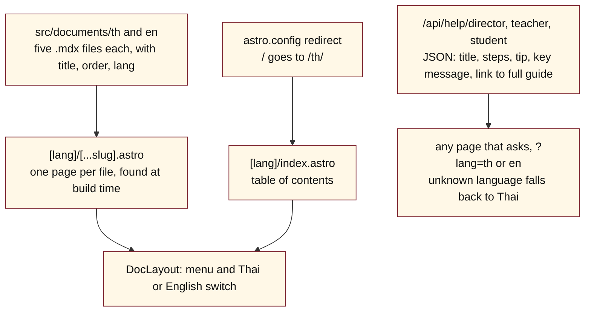

# NickoSystems instruction book — Module: Schools user guide (cuppathai-schools)

> How to use this file: Part 1 explains the module, Part 2 lists the files, Part 3 is the complete current code. No secret keys are included.

## Part 1. What this module is

- **What:** the written user guide for the CuppaThai school product, in Thai and English: Getting Started, Director, Teacher, Student, and Demo. It is a small static Astro site. It has no database and no login.
- **Repository:** https://github.com/CuppaThai/cuppathai-schools (**public**, so anyone can read it). Never put a secret or a real customer's details in it.
- **Where it is served:** the guide's own links point at `cuppathai-schools.pages.dev`. The repository has no Cloudflare config file, so the hosting setup is in the Cloudflare dashboard, not in the code.
- **Not the same as the village school:** the live school system is the village school Worker (see its module). This repository only holds the written guides and a tiny help API.

### Diagram 1. How the guide is built and read

### Editing the guide

1. Edit the .mdx file in **both** languages.
2. Keep the front matter: title, description, order, lang.
3. A new page needs a link added in `[lang]/index.astro`.
4. The short step lists in `/api/help/*` are written by hand in the code, separate from the .mdx pages. Change both when the process changes.

### Rules and known traps

- `05-demo` lists demo logins (a demo student, teacher code and director). They must stay demo-only accounts, because this repository is public.
- I found no page in the other repositories that calls `/api/help`. Check before changing its shape.
- The Teacher guide describes the institutional school flow (director, CSV upload, EPUB by Line). The paid village flow works differently (see the village school module), so do not copy village rules here.
